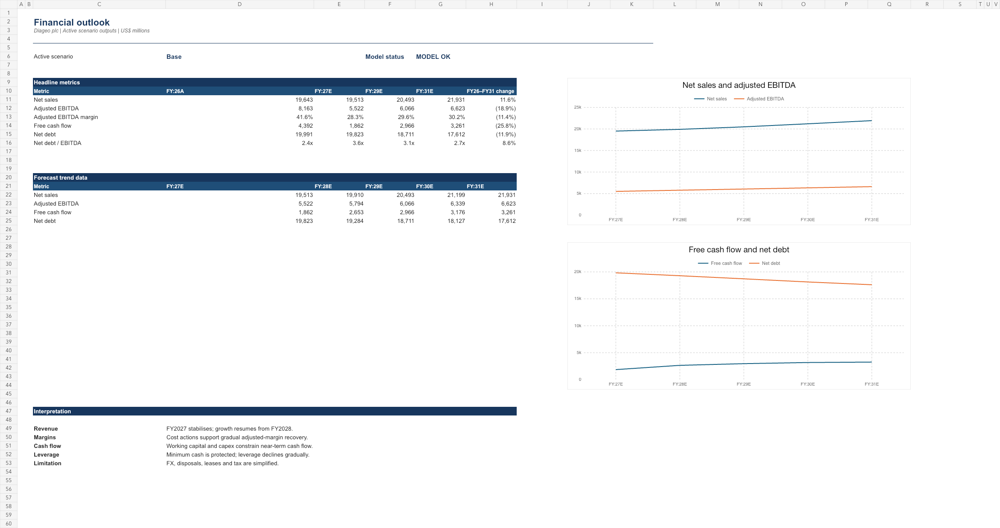
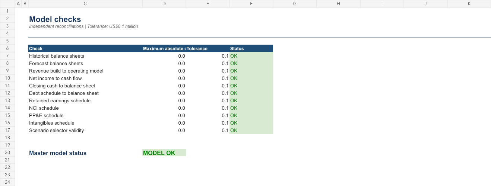

# Diageo Three-Statement Financial Model

An integrated Excel financial model for Diageo plc, developed as **Model 02** of an MSc Finance application portfolio. The model combines reported historical financials, a regional operating forecast, supporting schedules, three fully linked financial statements, scenario analysis, and automated integrity checks.

> **Purpose:** academic and portfolio demonstration only. This is not investment advice.

## Download the model

**[Download the final Excel workbook](Model/Diageo_Three_Statement_Model.xlsx?raw=1)**

The workbook is presented in US$ millions and uses Diageo's 30 June fiscal year-end.

## Dashboard preview



## Model architecture

| Workbook tab | Purpose |
|---|---|
| Cover | Scope, conventions, sources, limitations, and model status |
| Assumptions | Scenario selector and operating, cash-flow, financing, and equity drivers |
| Historicals | FY2024–FY2026 reported financial statements |
| Revenue Build | Regional revenue forecast across five operating regions and corporate items |
| Operating Model | Adjusted and reported income-statement forecast |
| Schedules | Working capital, PP&E, intangibles, debt, interest, retained earnings, and NCI |
| Three Statements | Integrated income statement, balance sheet, and cash-flow statement |
| Scenarios | Base, upside, and downside case outputs |
| Dashboard | Headline operating, cash-flow, and leverage trends |
| Checks | Independent reconciliation and formula-integrity tests |

## Base-case forecast snapshot

| Metric | FY2027E | FY2031E |
|---|---:|---:|
| Net sales | $19,513m | $21,931m |
| Adjusted EBITDA | $5,522m | $6,623m |
| Adjusted EBITDA margin | 28.3% | 30.2% |
| Free cash flow | $1,862m | $3,261m |
| Net debt | $19,823m | $17,612m |
| Net debt / adjusted EBITDA | 3.6x | 2.7x |

The base case assumes FY2027 stabilisation followed by gradual regional growth, measured margin recovery, and progressive deleveraging.

## Scenario analysis

On the `Assumptions` tab, change cell `D8`:

- `1` — Downside
- `2` — Base
- `3` — Upside

The selection updates the operating forecast, supporting schedules, three statements, scenario output page, dashboard, and model checks.

## Model integrity

- Forecast balance sheets reconcile within the model's $0.1m tolerance.
- Cash, debt, retained earnings, NCI, PP&E, and intangible schedules link to the financial statements.
- Revenue build and net income reconcile to their downstream statements.
- A minimum-cash revolver mechanism is included without introducing circular references.
- Interest expense uses opening debt to keep the model transparent and auditable.
- The completed workbook reports `MODEL OK` and passed the formula-error scan used during QA.



## Repository contents

```text
.
├── Model/          Final Excel workbook
├── Screenshots/    Previews of all workbook tabs
├── Sources/        Official source register
├── QA/             Compressed workbook inspection output
├── Development/    Workbook-generation script retained for provenance
└── README.md
```

## Sources

Historical data comes from Diageo's published investor materials, principally its FY2026 financial statements and FY2025 annual report. See [Sources/SOURCES.md](Sources/SOURCES.md) for official links.

## Limitations

Forecast assumptions are illustrative. Foreign exchange, acquisitions and disposals, pensions, leases, and detailed jurisdictional tax effects are simplified. Interest is calculated using opening debt, and the forecast is not intended to reproduce company guidance or constitute a recommendation.

## Disclaimer

This project was prepared independently for educational and academic-application purposes. Diageo plc did not commission, review, or endorse it. All trademarks and published financial information remain the property of their respective owners.
